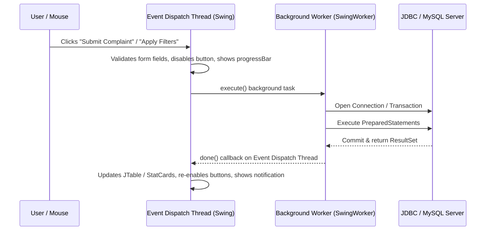
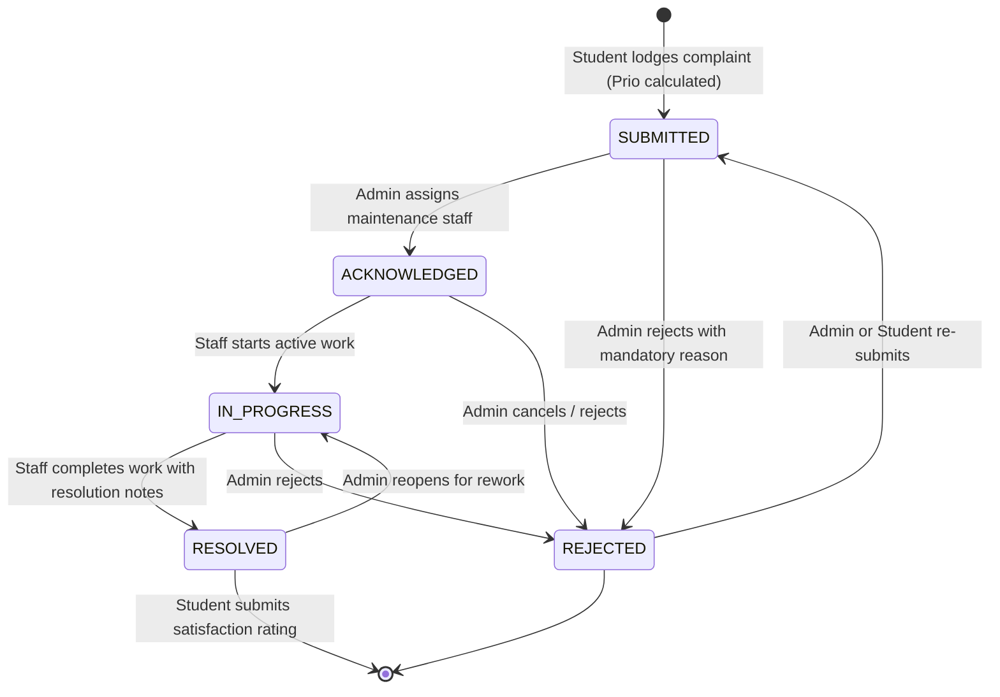

# System Architecture Documentation
## Smart Campus Complaint Prioritization and Tracking System

### 1. High-Level Architecture Overview

The Smart Campus Complaint Prioritization and Tracking System is designed as an enterprise-grade native desktop application using a clean multi-tier architecture. It strictly decouples graphical rendering, service-layer business rules, security context, and relational database persistence.

```mermaid
graph TD
    subgraph Presentation Layer (Java Swing & FlatLaf)
        LF[LoginFrame & RegistrationDialog]
        SD[Student Dashboard & Submission]
        AD[Admin Control Center & Management]
        MD[Staff Dashboard & Work Progress]
        CD[Complaint Details & Tracking Dialog]
    end

    subgraph Security & Context Layer
        US[UserSession Context Singleton]
        PW[PasswordUtil (BCrypt Cost 12)]
        VU[ValidationUtil & CSV Sanitizer]
    end

    subgraph Service Layer (Business Rules & Engine)
        PE[PriorityService Scoring Engine]
        CS[ComplaintService Workflow Manager]
        USrv[UserService & Identity Manager]
        DHS[DatabaseHealthService]
    end

    subgraph Data Access Layer (JDBC & PreparedStatements)
        CDAO[ComplaintDAO]
        UDAO[UserDAO]
        ADAO[ComplaintAssignmentDAO]
        HDAO[ComplaintStatusHistoryDAO]
        FDAO[ComplaintFeedbackDAO]
        ALDAO[AuditLogDAO]
    end

    subgraph Persistence Layer (MySQL 8.x)
        DB[(smart_campus_db)]
    end

    Presentation Layer -->|SwingWorker Async Calls| Service Layer
    Presentation Layer -.-> Security & Context Layer
    Service Layer --> Security & Context Layer
    Service Layer --> Data Access Layer
    Data Access Layer -->|JDBC Transactions| DB
```

---

### 2. Layered Responsibilities

#### Presentation Layer (`com.smartcampus.ui.*`)
- Built exclusively with Java Swing (`JFrame`, `JPanel`, `JTable`, `JDialog`, `JTextField`, `JTextArea`, `JComboBox`).
- Styled using **FlatLaf** (`FlatLightLaf`) for a consistent, modern, clean aesthetic.
- Custom UI renderers (`BadgeCellRenderer`) render rounded colored pill badges for priority levels (`CRITICAL`, `HIGH`, `MEDIUM`, `LOW`) and lifecycle statuses (`SUBMITTED`, `ACKNOWLEDGED`, `IN_PROGRESS`, `RESOLVED`, `REJECTED`).
- Dashboard metric cards (`StatCard`) provide visual KPI summaries with left accent bars and bold typography.
- Background threads (`SwingWorker`) handle all database operations, ensuring the Swing Event Dispatch Thread (EDT) never stutters or freezes.

#### Security & Context Layer (`com.smartcampus.security.*`, `com.smartcampus.util.*`)
- **`UserSession`**: Thread-safe authentication holder tracking the authenticated campus user, enforcing role-based permissions (`requireRole`), and restricting student access to their own complaints (`checkStudentOwnership`).
- **`PasswordUtil`**: Uses the BCrypt adaptive hashing algorithm with work factor 12. Cleans sensitive memory buffers immediately after verification.
- **`ValidationUtil`**: Enforces strict RFC email formatting, strong password complexity rules, numerical boundary validations, and spreadsheet formula neutralization (`'=`, `'+`, `'-`, `'@`) to prevent CSV injection attacks.

#### Service Layer (`com.smartcampus.service.*`)
- **`PriorityService`**: Deterministic scoring engine executing $P = 20 \times (0.35S + 0.30R + 0.20A + 0.15I)$. It calculates authoritative scores on the application side and flags safety overrides ($R \ge 4$, $S=5$ with hazard, or security categories) for human review.
- **`ComplaintService`**: Orchestrates complaint lodging, assignment dispatch, progress updates, resolutions, rejections, feedback submission, and CSV reporting with ACID transactional guarantees.
- **`UserService`**: Manages authentication, student self-registration (strictly locked to `STUDENT`), admin-controlled staff provisioning, password changes, and audit logging.

#### Data Access Layer (`com.smartcampus.dao.*`)
- Pure JDBC implementation utilizing `PreparedStatement` with parameterized placeholders to eliminate SQL injection vulnerabilities.
- Handles atomic multi-table updates (e.g., complaint status update + history insertion + audit logging) inside database transactions (`conn.setAutoCommit(false)` and `conn.commit()`).
- Encapsulates database queries, mapping `ResultSet` rows cleanly to strongly typed domain models.

---

### 3. Threading and Concurrency Architecture

To satisfy strict desktop responsiveness guidelines, the application strictly adheres to the Java Swing Single-Thread Rule:



1. **All UI modifications occur on the EDT**: Table updates, dialog visibility, button toggles, and card counts are always dispatched to the EDT.
2. **All database I/O is asynchronous**: Network queries, transactions, and report generation execute on background worker threads (`SwingWorker<T, V>`), ensuring zero UI freeze.
3. **Double-submission prevention**: Action buttons are disabled immediately upon invocation and re-enabled in the `done()` callback.

---

### 4. Complaint Lifecycle State Machine



Every transition in this lifecycle is validated by `ComplaintStatus.canTransitionTo()` and atomically logged into `complaint_status_history` with actor ID, old status, new status, timestamp, and remarks.
