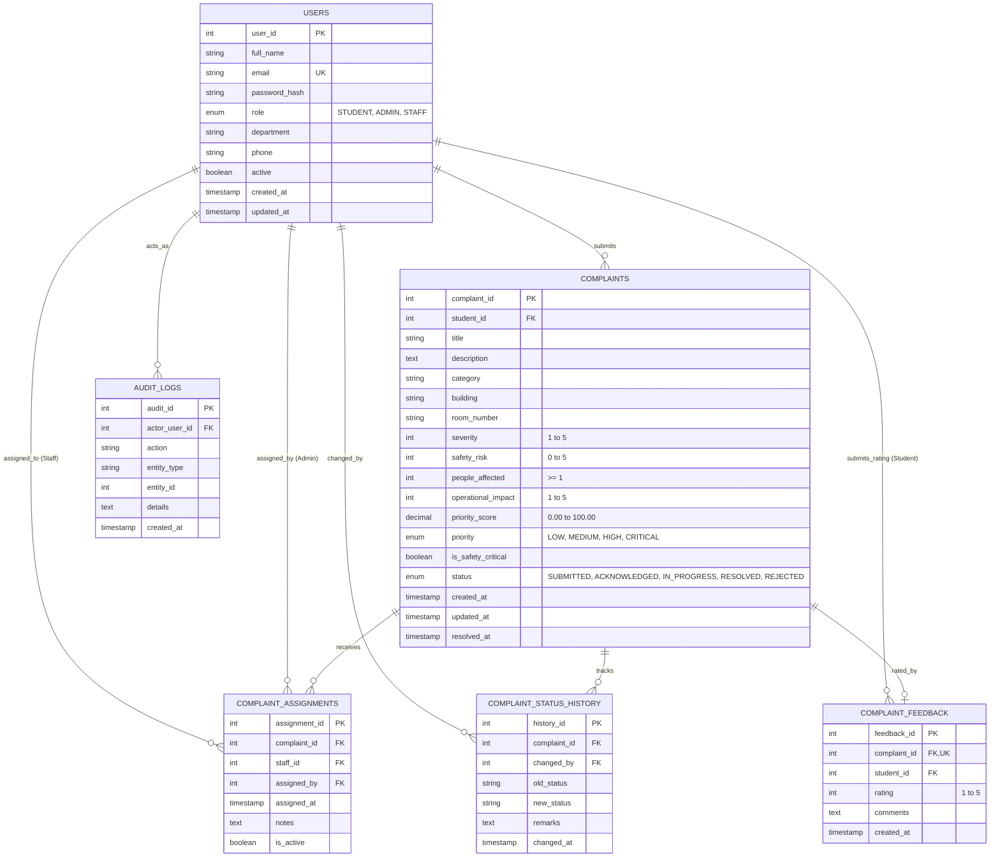

# Database Design & Relational Schema
## Smart Campus Complaint Prioritization and Tracking System

### 1. Entity-Relationship Diagram (ERD)

---

### 2. Table Specifications

#### 1. `users`
Persists registered campus users, authentication credentials, and permission roles.
| Column | Type | Constraints | Description |
|---|---|---|---|
| `user_id` | INT | PK, AUTO_INCREMENT | Unique user identifier |
| `full_name` | VARCHAR(100) | NOT NULL | User's full name |
| `email` | VARCHAR(150) | NOT NULL, UNIQUE | University email address (login credential) |
| `password_hash` | VARCHAR(255) | NOT NULL | BCrypt salted hash (Cost 12) |
| `role` | ENUM | NOT NULL | Role: `STUDENT`, `ADMIN`, `STAFF` |
| `department` | VARCHAR(100) | NULL | Academic department or maintenance trade |
| `phone` | VARCHAR(20) | NULL | Contact phone number |
| `active` | BOOLEAN | NOT NULL DEFAULT TRUE | Account state (soft deactivation supported) |
| `created_at` | TIMESTAMP | DEFAULT CURRENT_TIMESTAMP | Registration timestamp |
| `updated_at` | TIMESTAMP | ON UPDATE CURRENT_TIMESTAMP | Last modification timestamp |

#### 2. `complaints`
Central repository for campus complaints, priority scores, and lifecycle statuses.
| Column | Type | Constraints | Description |
|---|---|---|---|
| `complaint_id` | INT | PK, AUTO_INCREMENT | Unique complaint tracking number |
| `student_id` | INT | FK `users(user_id)` | Submitting student |
| `title` | VARCHAR(200) | NOT NULL | Concise complaint title |
| `description` | TEXT | NOT NULL | Detailed description of the issue |
| `category` | VARCHAR(50) | NOT NULL | Complaint category |
| `building` | VARCHAR(100) | NOT NULL | Campus facility / building |
| `room_number` | VARCHAR(50) | NOT NULL | Room or area identifier |
| `severity` | INT | CHECK (1..5) | Technical severity (1 to 5) |
| `safety_risk` | INT | CHECK (0..5) | Physical/safety hazard (0 to 5) |
| `people_affected` | INT | CHECK (>= 1) | Estimated count of impacted persons |
| `operational_impact` | INT | CHECK (1..5) | Operational disruption level (1 to 5) |
| `priority_score` | DECIMAL(5,2) | NOT NULL | Computed score (0.00 to 100.00) |
| `priority` | ENUM | NOT NULL | Classification: `LOW`, `MEDIUM`, `HIGH`, `CRITICAL` |
| `is_safety_critical` | BOOLEAN | DEFAULT FALSE | Flag indicating emergency safety override |
| `status` | ENUM | DEFAULT 'SUBMITTED' | Lifecycle status |
| `created_at` | TIMESTAMP | DEFAULT CURRENT_TIMESTAMP | Submission timestamp |
| `updated_at` | TIMESTAMP | ON UPDATE CURRENT_TIMESTAMP | Last update timestamp |
| `resolved_at` | TIMESTAMP | NULL | Timestamp when marked RESOLVED |

#### 3. `complaint_assignments`
Tracks dispatching of complaints to maintenance technicians.
| Column | Type | Constraints | Description |
|---|---|---|---|
| `assignment_id` | INT | PK, AUTO_INCREMENT | Assignment ID |
| `complaint_id` | INT | FK `complaints(complaint_id)` | Linked complaint |
| `staff_id` | INT | FK `users(user_id)` | Assigned maintenance technician |
| `assigned_by` | INT | FK `users(user_id)` | Administrator who assigned |
| `assigned_at` | TIMESTAMP | DEFAULT CURRENT_TIMESTAMP | Assignment timestamp |
| `notes` | TEXT | NULL | Administrative instructions |
| `is_active` | BOOLEAN | DEFAULT TRUE | Indicates current active assignment |

#### 4. `complaint_status_history`
Chronological immutable audit log of all complaint transitions.
| Column | Type | Constraints | Description |
|---|---|---|---|
| `history_id` | INT | PK, AUTO_INCREMENT | History record ID |
| `complaint_id` | INT | FK `complaints(complaint_id)` | Linked complaint |
| `changed_by` | INT | FK `users(user_id)` | User who enacted the change |
| `old_status` | VARCHAR(30) | NULL | Previous lifecycle status |
| `new_status` | VARCHAR(30) | NOT NULL | New lifecycle status |
| `remarks` | TEXT | NULL | Mandatory work note, rejection reason, or resolution summary |
| `changed_at` | TIMESTAMP | DEFAULT CURRENT_TIMESTAMP | Event timestamp |

#### 5. `complaint_feedback`
Stores student ratings and feedback upon resolution.
| Column | Type | Constraints | Description |
|---|---|---|---|
| `feedback_id` | INT | PK, AUTO_INCREMENT | Feedback record ID |
| `complaint_id` | INT | FK `complaints`, UNIQUE | One feedback record per complaint |
| `student_id` | INT | FK `users(user_id)` | Student submitting rating |
| `rating` | INT | CHECK (1..5) | 1 to 5 star rating |
| `comments` | TEXT | NULL | Student comments |
| `created_at` | TIMESTAMP | DEFAULT CURRENT_TIMESTAMP | Submission timestamp |

#### 6. `audit_logs`
High-level security and administrative audit trail.
| Column | Type | Constraints | Description |
|---|---|---|---|
| `audit_id` | INT | PK, AUTO_INCREMENT | Audit entry ID |
| `actor_user_id` | INT | FK `users(user_id)` | User who executed action |
| `action` | VARCHAR(100) | NOT NULL | Action code (e.g., `LOGIN`, `SUBMIT_COMPLAINT`) |
| `entity_type` | VARCHAR(50) | NOT NULL | Entity (e.g., `COMPLAINT`, `USER`, `REPORTS`) |
| `entity_id` | INT | NULL | Primary key of modified entity |
| `details` | TEXT | NULL | Human-readable audit narrative |
| `created_at` | TIMESTAMP | DEFAULT CURRENT_TIMESTAMP | Event timestamp |

---

### 3. Indexes & Performance Optimization
- `idx_complaints_status`: High-frequency filtering by lifecycle stage.
- `idx_complaints_priority`: Sorting and queue prioritization by score and severity.
- `idx_complaints_student`: Enforces instantaneous lookup of student's personal complaints.
- `idx_complaints_category`: Real-time dashboard KPI grouping.
- `idx_assignments_lookup (complaint_id, staff_id, is_active)`: Instantaneous lookup for staff tasks.
- `idx_history_complaint`: Fast chronological timeline rendering.
